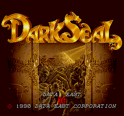

# 다크 실 — 아케이드

아케이드 **다크 실** 한글 번역 패치 프로젝트입니다. 판타지 세계의 영웅들을 조작하는 액션 RPG입니다.

> **정식 배포 v1.0**

<!-- game-preview:start -->

  

**타이틀 · 원문 로고** — 사용자가 촬영한 FBNeo 타이틀 화면. 설치 패치 7개가 공개 v1.0과 해시 일치하며 타이틀 로고는 원문입니다.
<!-- game-preview:end -->

## 다운로드 및 적용 방법

1. 아래 체크섬 또는 상세 안내와 일치하는 원본을 준비합니다.
2. [최종 배포 패치 다운로드](https://github.com/akuma815/arcade-dark-seal-kr-patch/releases/tag/v1.0)에서 ZIP을 받아 모두 압축 해제합니다.
3. ZIP의 `support` 폴더를 FBNeo 설치 폴더에 복사합니다.
4. IPS Manager에서 `Korean`을 선택하거나 `fbneo64.exe darksealj -ips Korean`으로 실행합니다.

## 주의사항

- 일본판 rev 4의 darksealj 및 부모 darkseal 세트가 필요합니다.
- FBNeo IPS 패치이며 부모 세트만 실행하면 적용되지 않습니다.
- 원본 게임·BIOS 및 패치가 적용된 게임 이미지는 포함하지 않습니다.

## 체크섬

| 구분 | SHA-256 |
| --- | --- |
| 패치 파일 `Korean-fz_00-2_h12.ips` | `ef28602380f50e698bc86736591c75ad792c80c9174fe5c4ee75263960363f02` |
| 패치 파일 `Korean-fz_01-4_h14.ips` | `bb8b91657bfe5791f974553d5db59cdf61a95302b539fe4d4e01928e74c1cab5` |
| 패치 파일 `Korean-fz_02_j1.ips` | `d217c375395d03368817e5c64c6ee494c0c82b3095cd095045193aa8d4d1a81d` |
| 패치 파일 `Korean-fz_03_j2.ips` | `2a67c62f7e23f2cbbb5395cc07e58082daff3b9250afeba96263285b8541fd56` |
| 패치 파일 `Korean-fz_04-4_j12.ips` | `af1bd61c17baff556f4af8fb9dcfbbb2200063fa8aaea47be57be2b0c529647e` |
| 패치 파일 `Korean-fz_05-2_j14.ips` | `c76b679854b44de36d774b6cfb5d131ab578ecc10280a67dfada5bc737ad3d31` |
| 배포 압축 파일 | `f33a3774ed31f8092b601eb197232e388d625f5506835cb2f0b2fbd0a2c5d1e1` |

지원 원본의 세트·리비전 및 해시는 [상세 패치 안내](docs/PATCH_GUIDE.txt)를 확인하세요.

## 소스 및 작업 기록

[공개 소스 구성과 빌드 전제](docs/SOURCE_GUIDE.md) · [상세 패치 안내](docs/PATCH_GUIDE.txt)
